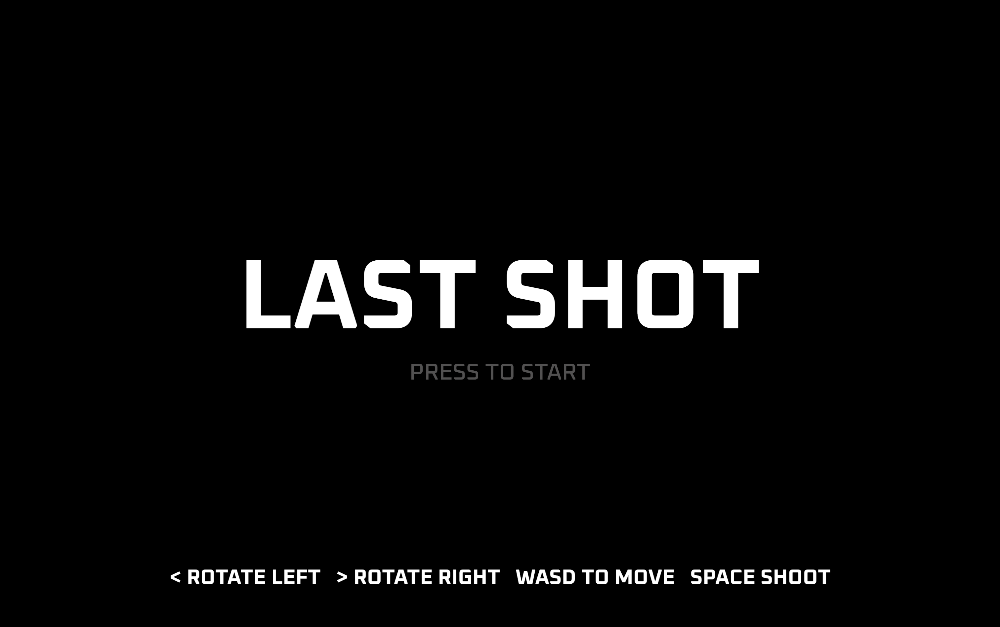
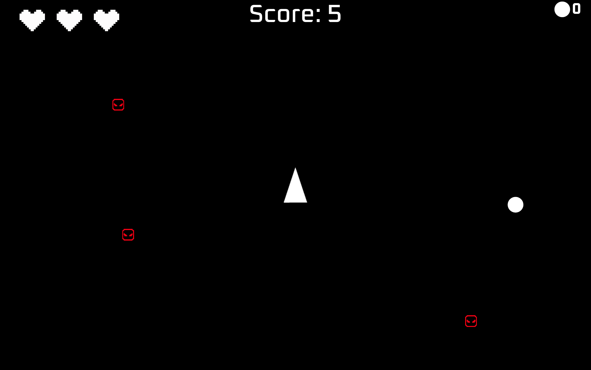
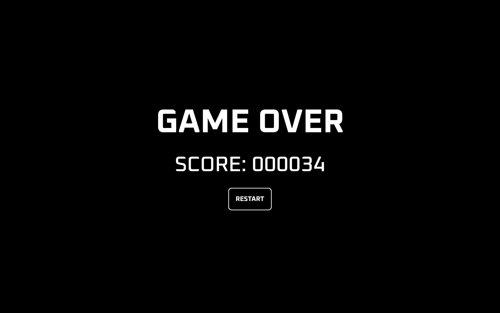

# Last Shot

A minimal retro arcade shooter where every bullet counts.

**Last Shot** is a survival game where you control a spaceship, dodge enemies, and use a single bouncing bullet to eliminate them. Your spaceship can also deflect the bullet, changing its trajectory.

## Gameplay

- Start with **one bullet** that bounces around the arena and can hit multiple enemies.
- Each bullet persists for **6 seconds** after being used before despawning.
- A new bullet becomes available every **15 seconds** and can be fired whenever you choose.
- Use your spaceship to deflect bullets and alter their trajectory.
- Earn **+1 point every second** and **+5 points for every enemy eliminated**.

**One bullet. Endless possibilities. Make your last shot count.**
